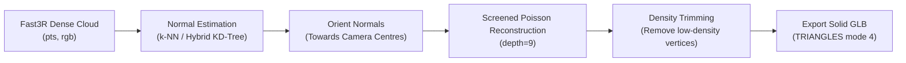

# 01 — Surface Meshing (Turning Points into a Solid 3D Model)

## 1. Problem Statement

Fast3R predicts dense 3D points $(X, Y, Z)$ and colors $(R, G, B)$ for pixels across video keyframes. However, it does not connect these points into triangles or surfaces. In the 3D viewer, points appear as floating dots.

To produce an **actual solid 3D model**, the pipeline needs a **Surface Reconstruction Stage** that computes surface normals, builds a polygonal mesh (triangles), trims noise, and exports a standard 3D asset (`.glb` / `.obj`).

---

## 2. Recommended Technology: Open3D (Screened Poisson + Ball-Pivoting)

* **Repository**: [`isl-org/Open3D`](https://github.com/isl-org/Open3D)
* **Licence**: **MIT Licence** (Permissive, 100% free for open-source, academic, and commercial use).
* **Dependencies**: Pre-compiled binaries available on PyPI. No CUDA compiling, no C++ build tools, no downloading neural checkpoints.
* **Installation**:
  ```bash
  uv add --package nazar-worker open3d
  ```

---

## 3. Algorithmic Pipeline



### Key Technical Details

1. **Normal Estimation**:
   Poisson surface reconstruction requires oriented normal vectors $\vec{n} = (n_x, n_y, n_z)$ for every point. Open3D computes covariance eigenvalues across neighboring points ($k=30$ or radius $r=0.08\text{ units}$).
2. **Normal Orientation**:
   Normals must point outwards toward the camera trajectory. For drone aerial footage, each point's normal is flipped so that $\vec{n} \cdot (\vec{c}_{cam} - \vec{p}) > 0$.
3. **Screened Poisson Reconstruction**:
   Solves an indicator function $\chi$ whose gradient matches the vector field: $\nabla \chi = \vec{V}$. Extracts the isosurface using Marching Cubes at octree depth $8\text{--}10$.
4. **Density Trimming**:
   Poisson reconstruction fills unobserved areas with large, smooth "bubbles". We prune vertices whose Poisson sampling density is below the 5th percentile, leaving only the real reconstructed scene.
5. **Vertex Color Transfer**:
   Transfers RGB colors from the nearest Fast3R points to the mesh vertices via KD-tree query.

---

## 4. Concrete Worker Implementation

Create a new worker module `apps/worker/src/nazar_worker/surface.py`:

```python
"""Surface reconstruction: converts a dense point cloud into a solid triangle mesh."""

from dataclasses import dataclass
from pathlib import Path
import numpy as np
import numpy.typing as npt
import open3d as o3d


@dataclass
class MeshOutput:
    vertices: npt.NDArray[np.float64]   # (N, 3)
    triangles: npt.NDArray[np.int32]     # (M, 3)
    colors: npt.NDArray[np.float64]      # (N, 3) in [0, 1]
    normals: npt.NDArray[np.float64]     # (N, 3)
    byte_content: bytes                  # Binary GLB content


def reconstruct_surface_poisson(
    points: npt.NDArray[np.float64],
    colors: npt.NDArray[np.uint8],
    camera_centers: npt.NDArray[np.float64],
    depth: int = 9,
    density_trim_percentile: float = 5.0,
) -> MeshOutput:
    """Run Screened Poisson Surface Reconstruction on Fast3R points."""
    # 1. Create Open3D PointCloud
    pcd = o3d.geometry.PointCloud()
    pcd.points = o3d.utility.Vector3dVector(points.astype(np.float64))
    pcd.colors = o3d.utility.Vector3dVector(colors.astype(np.float64) / 255.0)

    # 2. Estimate surface normals
    pcd.estimate_normals(
        search_param=o3d.geometry.KDTreeSearchParamHybrid(radius=0.15, max_nn=30)
    )

    # 3. Orient normals towards drone camera positions
    if len(camera_centers) > 0:
        mean_cam = camera_centers.mean(axis=0)
        pcd.orient_normals_towards_camera_location(mean_cam)

    # 4. Screened Poisson Surface Reconstruction
    mesh, densities = o3d.geometry.TriangleMesh.create_from_point_cloud_poisson(
        pcd, depth=depth, linear_fit=True
    )

    # 5. Trim low-density hallucinated surfaces
    densities_np = np.asarray(densities)
    if len(densities_np) > 0:
        threshold = np.percentile(densities_np, density_trim_percentile)
        vertices_to_remove = densities_np < threshold
        mesh.remove_vertices_by_mask(vertices_to_remove)

    # 6. Clean mesh
    mesh.remove_degenerate_triangles()
    mesh.remove_duplicated_triangles()
    mesh.remove_duplicated_vertices()
    mesh.remove_non_manifold_edges()

    # 7. Compute vertex normals for smooth shading
    mesh.compute_vertex_normals()

    verts = np.asarray(mesh.vertices)
    tris = np.asarray(mesh.triangles, dtype=np.int32)
    cols = np.asarray(mesh.vertex_colors)
    norms = np.asarray(mesh.vertex_normals)

    # 8. Export to GLB format
    import tempfile
    with tempfile.NamedTemporaryFile(suffix=".glb", delete=False) as tmp:
        tmp_path = Path(tmp.name)
    try:
        o3d.io.write_triangle_mesh(str(tmp_path), mesh, write_triangle_uvs=False)
        glb_bytes = tmp_path.read_bytes()
    finally:
        tmp_path.unlink(missing_ok=True)

    return MeshOutput(
        vertices=verts,
        triangles=tris,
        colors=cols,
        normals=norms,
        byte_content=glb_bytes,
    )
```

---

## 5. Integrating with `SurfaceProcessing` Stage

In [`apps/worker/src/nazar_worker/standard.py`](../../apps/worker/src/nazar_worker/standard.py):

Replace `_SurfaceSkip` with the real adapter:

```python
class SurfaceProcessing(_Stage):
    def run(self, ctx: StageContext) -> None:
        run = self.run_state
        if run.dense is None:
            ctx.warn("surface_skipped", "Cannot build mesh from sparse SfM baseline.", "info")
            return

        t0 = time.monotonic()
        ctx.progress("Computing surface normals and Poisson mesh...", 0, 100, "%")
        
        mesh_out = reconstruct_surface_poisson(
            points=run.dense.points,
            colors=run.dense.colors,
            camera_centers=run.dense.centers,
            depth=9,
        )

        ctx.progress("Surface mesh generated", 100, 100, "%")
        
        # Publish artifact
        ctx.publish(
            _declare(
                run,
                "surface-mesh",
                ArtifactKind.MESH,
                "model/gltf-binary",
                mesh_out.byte_content,
                xyz=mesh_out.vertices,
                final=True,
                spatial=True,
            ),
            mesh_out.byte_content,
        )
        run.timings["surface_processing_s"] = round(time.monotonic() - t0, 3)
```

---

## 6. Frontend: Rendering the Solid Mesh in React Three Fiber

Update [`apps/web/src/components/layers.tsx`](../../apps/web/src/components/layers.tsx) with a `MeshLayer`:

```tsx
import { useLoader } from '@react-three/fiber';
import { GLTFLoader } from 'three/examples/jsm/loaders/GLTFLoader.js';

export function MeshLayer({ url }: { url: string }) {
  const gltf = useLoader(GLTFLoader, url);
  return (
    <primitive object={gltf.scene}>
      <meshStandardMaterial vertexColors roughness={0.6} metalness={0.1} />
    </primitive>
  );
}
```

In [`apps/web/src/components/ViewerScene.tsx`](../../apps/web/src/components/ViewerScene.tsx), add standard lighting so the 3D surface has depth:
```tsx
<ambientLight intensity={0.7} />
<directionalLight position={[10, 20, 15]} intensity={1.2} castShadow />
<directionalLight position={[-10, 10, -10]} intensity={0.4} />
```

---

## 7. Results & Verification Checklist

- [ ] `uv add --package nazar-worker open3d` succeeds.
- [ ] Running a job produces an `ArtifactKind.MESH` (`surface-mesh.glb`).
- [ ] Opening `surface-mesh.glb` in Windows 3D Viewer or Blender displays solid triangular faces with colors.
- [ ] Web 3D viewport renders the solid building/terrain instead of disconnected points.
