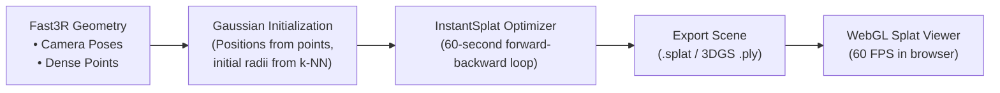

# 04 — Photorealistic Gaussian Scenes (InstantSplat / 3DGS)

## 1. What is 3D Gaussian Splatting (3DGS)?

Instead of representing 3D geometry as discrete points or solid flat triangles, **3D Gaussian Splatting** represents the scene as millions of overlapping, continuous 3D ellipsoids (Gaussians). Each Gaussian has:
* 3D Position $\mu \in \mathbb{R}^3$
* 3D Covariance matrix $\Sigma$ (Scale and Rotation quaternion)
* Opacity $\alpha \in [0, 1]$
* View-dependent color via Spherical Harmonics (SH)

When rendered in the web browser, these Gaussians blend seamlessly into a **100% solid, photorealistic continuous world** with realistic lighting, shadows, and reflections—completely eliminating the "dots" look of a point cloud.

---

## 2. Why InstantSplat?

Traditional 3DGS (Kerbl et al., SIGGRAPH 2023) requires:
1. Running COLMAP for 30–60 minutes to compute camera poses and sparse points.
2. Training for 30,000 iterations (15–25 minutes).

**InstantSplat (NVIDIA Research, CVPR 2024)** pairs directly with learned multi-view geometry (like Fast3R):
* Takes the camera poses and pointmaps already predicted by Fast3R in 5 seconds.
* Initializes Gaussians directly on the surface geometry.
* Runs a rapid co-optimization loop that converges in **under 60 seconds**.

---

## 3. Specifications & License

* **Paper**: *InstantSplat: Unbounded Scene Synthesis with Sparse Views in Seconds* (arXiv:2403.20309)
* **Repository**: [`NVlabs/InstantSplat`](https://github.com/NVlabs/InstantSplat)
* **Licence**: **Apache 2.0 License** for InstantSplat code; underlying `diff-gaussian-rasterization` uses the Inria/SIBR non-commercial research license.
* **Hardware Requirements**:
  * Minimum 6 GB VRAM for short scenes; 16+ GB recommended for large aerial sequences.
  * Requires CUDA C++ compilation (`simple-knn`, `diff-gaussian-rasterization`).
  * **Recommendation**: Best executed on the **College GPU (Linux VDI)** where CUDA compilation is native, rather than Windows MSVC.

---

## 4. End-to-End Execution Flow



---

## 5. Web Browser Rendering (Three.js / React Three Fiber)

To render 3D Gaussian Splats in the browser, integrate `@mkkellogg/gaussian-splats-3d`:

1. **Install web dependency**:
   ```bash
   pnpm --filter @nazar/web add @mkkellogg/gaussian-splats-3d
   ```
2. **Add a `SplatLayer` component** in `apps/web/src/components/SplatLayer.tsx`:
   ```tsx
   import { useEffect, useRef } from 'react';
   import { useThree } from '@react-three/fiber';
   import * as GaussianSplats3D from '@mkkellogg/gaussian-splats-3d';

   export function SplatLayer({ splatUrl }: { splatUrl: string }) {
     const { scene, camera, gl } = useThree();
     const viewerRef = useRef<GaussianSplats3D.Viewer | null>(null);

     useEffect(() => {
       const viewer = new GaussianSplats3D.Viewer({
         threeScene: scene,
         camera: camera,
         renderer: gl,
         useBuiltInControls: false,
         sharedMemoryForWorkers: false,
       });

       viewer.addSplatScene(splatUrl, {
         streamView: true,
       });

       viewerRef.current = viewer;
       return () => {
         viewer.dispose();
       };
     }, [splatUrl, scene, camera, gl]);

     return null;
   }
   ```

---

## 6. Comparison: Solid Mesh (01) vs. Gaussian Splatting (04)

| Feature | Open3D Poisson Mesh (01) | InstantSplat Gaussian Splat (04) |
| :--- | :--- | :--- |
| **Output Type** | Geometric surface mesh (`.glb` / `.obj`) | Volumetric Gaussian field (`.splat`) |
| **Appearance** | Clean architectural geometry, CAD-ready | Photorealistic visual reproduction |
| **Installation** | Trivial (`uv add open3d`, 10 seconds) | Heavy (C++ CUDA compilation) |
| **Measurement** | Direct point-to-point / area / volume | Visual inspection only |
| **Best Hardware** | Runs effortlessly on laptop CPU/GPU | Runs best on Linux College GPU |
| **Recommended Use**| **Immediate primary 3D output** | **Secondary photorealistic viewing mode** |
