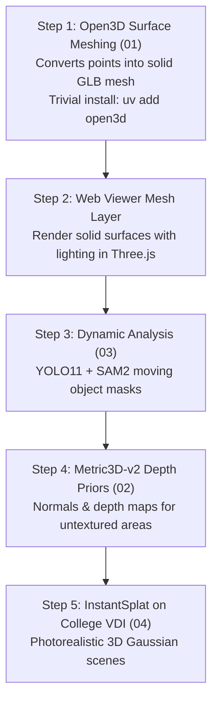

# Full Pipeline Completion Roadmap

This directory contains the complete technical blueprints, installation requirements, code specifications, and execution steps needed to take **NAZAR** from its current stage (Fast3R point clouds + GNSS telemetry alignment) to the **fully completed end-to-end 3D reconstruction system** specified in the NTRO SIH project brief.

---

## 1. Current State vs. Target Complete State

```
Current State (Milestone 3 & 4):
[Drone Video] ──▶ [Preflight] ──▶ [Fast3R / CPU SfM] ──▶ [Umeyama Sim(3)] ──▶ Point Cloud (.ply/.las/.glb)
                                                          (Telemetry)          (Points only, no mesh)

Target Complete State:
[Drone Video] ──▶ [Preflight] ──▶ [YOLO + SAM2] ──────▶ [Fast3R Multi-View] ─┬─▶ [InstantSplat 3DGS] (Photorealistic Scene)
                                   (Dynamic Masking)           │              │
                                                               ▼              ├─▶ [Open3D Poisson Meshing] (Solid Mesh .glb)
                                                      [Metric3D-v2 Depth] ────┤
                                                               │              └─▶ [Georeferenced LAS & UTM Export]
                                                               ▼
                                                      [Umeyama GNSS Sim(3)]
```

| Pipeline Stage | Current Implementation | Target Complete Implementation | Primary Technology |
| :--- | :--- | :--- | :--- |
| **Ingestion & Preflight** | **Complete** (chunked upload, Laplacian blur, viewpoint novelty) | Maintain existing | FFmpeg, ffprobe, OpenCV |
| **Dynamic Analysis** | **Skipped** (`_Stage` skip) | Moving object detection & masking across frames | **YOLO11 + SAM 2** |
| **Multi-View Geometry**| **Complete** (Fast3R GPU + OpenCV CPU SfM fallback) | Maintain existing | **Fast3R** ViT-L/512 (`var/gpu`) |
| **Depth Priors** | **Skipped** (`_Stage` skip) | Monocular metric depth maps & surface normal priors | **Metric3D-v2** |
| **Sensor Optimization**| **Complete** (Umeyama Sim(3) GNSS alignment) | Maintain existing | In-house SVD + Krüger UTM series |
| **Dense Scene** | **Point cloud only** (statistical outlier filter) | Continuous 3D Gaussian scene | **InstantSplat / 3DGS** |
| **Surface Processing** | **Skipped** (`_SurfaceSkip`) | Watertight solid triangular mesh (`mode: 4`) | **Open3D (Poisson & BPA)** |
| **Web 3D Viewer** | Three.js `<points>` cloud renderer | Dual renderer: Solid `<mesh>` + `<points>` + 3DGS | R3F, Drei, Three.js |

---

## 2. Document Index

Read each dedicated technical guide in sequence to implement and complete each stage:

1. **[`01-SURFACE-MESHING.md`](01-SURFACE-MESHING.md) — The Missing 3D Mesh (Highest Priority)**
   * Turns Fast3R's point cloud into a solid, continuous triangle mesh (`.glb` / `.obj`).
   * Uses Open3D (Screened Poisson Surface Reconstruction and Ball-Pivoting Algorithm).
   * Generates vertex normals, filters low-density outliers, and bakes vertex colors.
   * Updates Three.js viewer with `<mesh>` and `<meshStandardMaterial>`.
   * **License**: MIT (100% free, no neural weights, trivial `uv add open3d`).

2. **[`02-DEPTH-PRIORS-METRIC3D.md`](02-DEPTH-PRIORS-METRIC3D.md) — Metric Depth & Surface Normals**
   * Integrates Metric3D-v2 into the `depth_priors` stage.
   * Fills in textureless surfaces (roads, rooftops) that multi-view matching misses.
   * Outputs metric depth maps and normal vector fields to guide mesh reconstruction.
   * **License**: BSD 2-Clause (free open source).

3. **[`03-DYNAMIC-OBJECTS-YOLO-SAM2.md`](03-DYNAMIC-OBJECTS-YOLO-SAM2.md) — Dynamic Object Masking**
   * Detects and segments moving vehicles, pedestrians, and animals.
   * Generates binary dynamic masks per frame to prevent "ghosting" artifacts in the 3D model.
   * **License**: SAM 2 (Apache 2.0), YOLO (Ultralytics AGPL-3.0).

4. **[`04-GAUSSIAN-SPLATTING-INSTANTSPLAT.md`](04-GAUSSIAN-SPLATTING-INSTANTSPLAT.md) — Photorealistic 3D Scene**
   * Takes Fast3R keyframes and camera poses to train a 3D Gaussian Splatting scene in ~1 minute.
   * Enables continuous, photorealistic rendering in the web browser without floating dots.
   * **License**: Apache 2.0 / Inria non-commercial research.

5. **[`05-HARDWARE-AND-COLLEGE-DEPLOYMENT.md`](05-HARDWARE-AND-COLLEGE-DEPLOYMENT.md) — Environments & Deployment**
   * Laptop GPU (RTX 4050 6GB) vs. College GPU (Linux VDI A-series).
   * Isolated environment pins under [ADR-0004](../decisions/ADR-0004-isolated-model-environments.md).
   * Online worker pull loop vs. offline bundle mode.

---

## 3. Recommended Implementation Order


